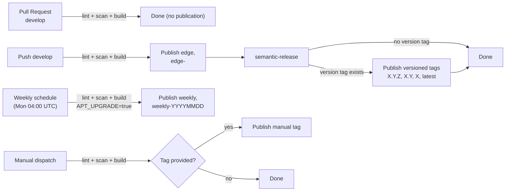
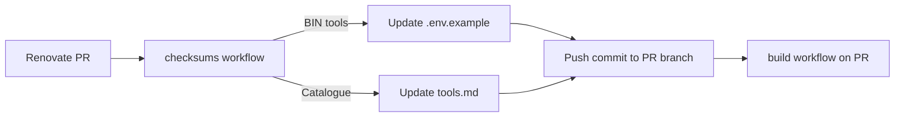

# Automation

GitHub Actions runs three workflows: one for all builds, one for dependency checksums, and one for Neovim updates. Renovate proposes version bumps. `semantic-release` creates version tags for releases on `develop`. All automation targets Linux x86-64 images on GHCR.

## Workflow Triggers

| Workflow | Trigger | Output |
|---|---|---|
| **build** | PR on `develop` | Lint, scan, build. Image in build cache only. |
| **build** | Push to `develop` | Lint, scan, build. Publish `edge`, `edge-<sha>`, run semantic-release. |
| **build** | Weekly schedule (Mon 04:00 UTC) | Lint, build with `APT_UPGRADE=true`. Publish `weekly`, `weekly-YYYYMMDD`. |
| **build** | Manual dispatch | Lint, scan, build. Publish manual tag if provided, or cache only. |
| **checksums** | Renovate PR (`.env.example`) | Refresh BIN checksums and tools catalogue. Push commit to PR. |
| **nvim-lock** | Monthly (1st 05:00 UTC) | Update Neovim plugins via `:Lazy! update`, open PR. |

## Main Pipeline

## Freshness Guard

After Docker Build on develop push triggers, a freshness check compares the triggering commit SHA to the remote `origin/develop` tip. If they differ, the workflow completes lint → scan (build only) and skips publish. The guard does not provide atomic serialization against concurrent pushes.

| Situation | Build | Publish |
|---|---|---|
| Normal develop push | ✓ | ✓ |
| Stale rerun (develop moved) | ✓ | Skipped |
| PR (pre-merge) | ✓ | — |
| Manual dispatch (tag) | ✓ | ✓ |
| Manual dispatch (no tag) | ✓ | — |
| Weekly schedule | ✓ | ✓ |

## Dependency Updates

Source: [Renovate config](../../renovate.json), [checksums workflow](../../.github/workflows/checksums.yml), [nvim-lock workflow](../../.github/workflows/nvim-lock.yml).

| Workflow | Frequency | Creates |
|---|---|---|
| Renovate | Weekly (Monday) | PR with version bumps in `.env.example` |
| Checksums | On PR push | PR commit with updated BIN checksums and tools catalogue (`.cicd/docs/update-tools.sh`) |
| Nvim-lock | Monthly (1st 05:00 UTC) | PR with updated Neovim plugin pins |

Merge PRs only when the build workflow is green on the **final refreshed commit**. See [Image Maintenance – Review an Update](../playbooks/image-maintenance.md#review-an-update) for details on running the checksum generator safely.

## Release Rules

Source: [.releaserc.yml](../../.releaserc.yml)

- `feat:` → minor release
- `fix:`, `build:`, `dep:`, `perf:`, `revert:`, `style:` → patch release
- `breaking: true` → major release
- `ci:`, `cicd:`, `chore:`, `docs:`, `refactor:`, `test:` → no release

The same built image is tagged as versioned — no second build. The stale build guard (see [Freshness Guard](#freshness-guard)) also prevents publishing on reruns where `develop` has moved.

## GitHub Settings

| Item | Used by |
|---|---|
| `WORKFLOW_TOKEN` (secret) | GHCR publish, semantic-release `GITHUB_TOKEN`, checksums push |
| `GHCR_USERNAME` (variable) | GHCR login; defaults to `igor-sadza` |
| Renovate app + automerge | Dependency PRs |
| Branch protection (develop) | Required checks before merge |

## Failure Recovery

| Problem | Action |
|---|---|
| Versioned image publication fails after release | Use `edge-<sha>` from the exact failed develop run for recovery |
| Publication skipped — develop moved | Build-only run publishes no image tag; use a current eligible develop push or manual dispatch for recovery |
| No version after qualifying commits | Check commit message format, `.releaserc.yml`, and branch name |
| Weekly tag not created | Verify workflow run in GitHub Actions history |
